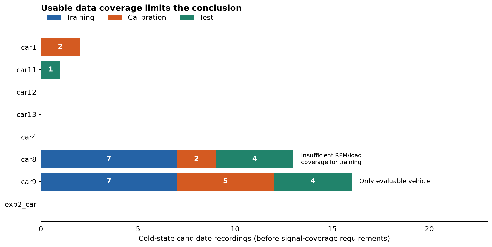
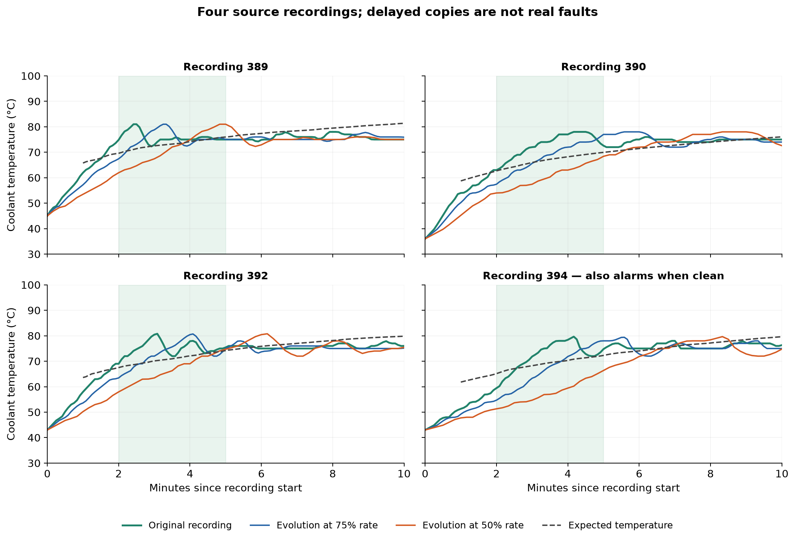
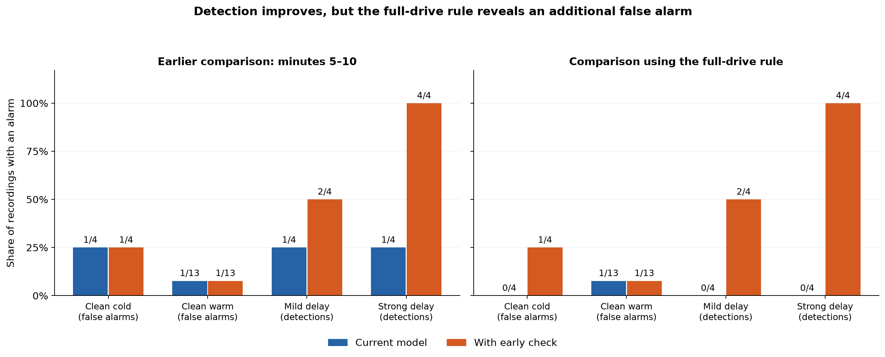
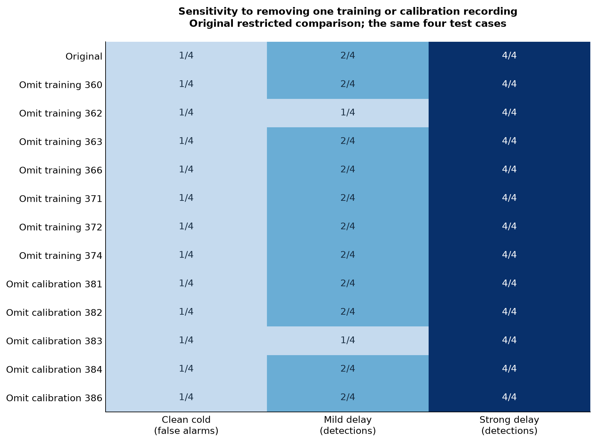
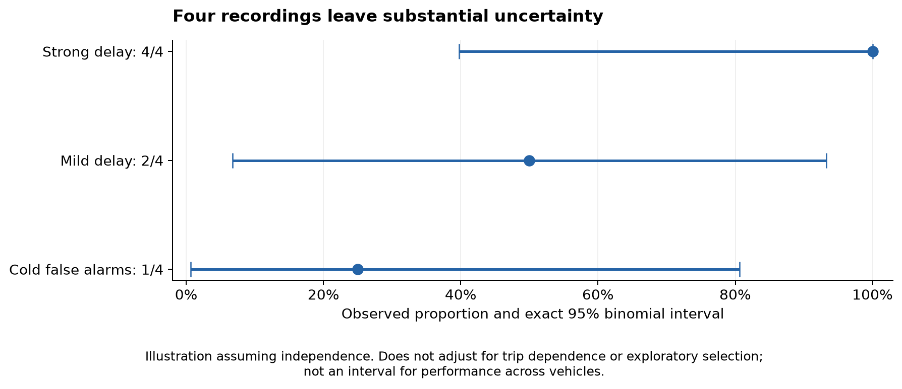

# Final report: thermostat slow warm-up detection

**Date:** October 16, 2026

**Investigation:** [issue #34](https://github.com/TylerMichael06/Deep-Learning-Under-the-Hood/issues/34) · branch `cristian/34-thermostat-warmup` · base revision `c82fec0`

**Status:** experimental; not integrated into the default detector.

## 1. Conclusion and decision

**There is insufficient evidence to determine that the additional detector improves the model in general.** Detection of artificial delays, particularly strong delays, improves reproducibly within four recordings from a single vehicle. However, applying the original full-drive rule reveals an additional false alarm. Detection of real thermostat failures and generalization to another vehicle have not been demonstrated.

| Question | Answer supported by the experiments |
|---|---|
| Does it detect more artificially slow warm-up cases in the available data? | Yes: under the full-drive rule, detection increases from 0/4 to 2/4 for the mild delay and from 0/4 to 4/4 for the strong delay. |
| Is the improvement free of additional false alarms? | No: alarms on clean controls increase from 1/17 to 2/17. |
| Can we claim that it improves the model in general? | No: only one vehicle is evaluable, the faults are artificial, and the sample is very small. |
| Can we conclude that it is ineffective? | No: sensitivity to the strong delay is consistent across the checks performed. |
| What is recommended? | Keep it as an optional experiment and collect independent evidence before enabling it by default. |

This report consolidates the work, explains how the data were selected, and distinguishes observed results from conclusions they cannot yet support. The report tables and PNG figures are included in version control; reading the report does not require local experiment outputs. Generated CSV tables and JSON manifests stay local and are excluded from Git.

## 2. Problem investigated

Low coolant temperature alone does not imply a fault: the engine may simply have started cold. The useful question is whether **it is warming less than expected given its initial state and activity**.

The existing detector uses a Transformer to reconstruct hidden sensors and measure prediction errors. It adds a frozen-temperature-sensor check and suppresses general alarms during the first five minutes. This protection against false alarms can hide early differences between normal and slow warming. A sensor that changes slowly also need not trigger the frozen-sensor check.

We investigated an additional component, `WarmupRise`, that learns each vehicle's normal temperature rise. It does not replace the Transformer and is not a new neural-network architecture: it is a regularized regression that produces a complementary score.

Ford's thermostat monitor also uses expected temperature and enabling conditions, and accounts for low-load situations that can produce incorrect diagnoses. This motivates the expected-versus-observed comparison, but **does not validate our method or make its thresholds universal**. [Ford monitor description, pp. 123–124](https://www.fordservicecontent.dealerconnection.com/Ford_Content/Catalog/OBDII/OBDSM1300.pdf#page=123).

## 3. Available data and why they were used

### 3.1 Source and unit of analysis

We used the three Kaggle CSV files already consumed by the repository:

- `exp1_14drivers_14cars_dailyRoutes.csv`.
- `exp2_19drivers_1car_1route.csv`.
- `exp3_4drivers_1car_1route.csv`.

The loader produces **472 recording segments from 15 vehicle identifiers**, on a five-second grid. A segment may begin with a warm engine or partway through a drive; it should not automatically be treated as a complete drive from ignition.

In **323 segments**, engine runtime is missing and elapsed recording time is used instead. An initial value of zero therefore does not confirm an engine start. We added `runtime_source` provenance to distinguish these cases without changing the original model's input values.

The relevant unit for evaluating detection is the source recording; the vehicle also matters when assessing generalization across vehicles. Overlapping windows, artificial copies, and repetitions with different random seeds **do not increase the number of vehicles or source recordings**.

### 3.2 Selection criteria and rationale

| Fixed criterion | Rationale |
|---|---|
| Initial ECT below 50 °C | Study recordings that begin relatively cold. This is an exploratory condition, not a universal diagnostic threshold. |
| First ECT within the first minute and at least 80% ECT coverage | Observe enough of the initial state and temperature evolution. |
| At least six valid windows after minute five | Allow comparison with the original late-period protocol. This excludes some short drives. |
| No engine codes recorded anywhere in the segment; exclude `car6` | Avoid using segments with recorded problems as normal references. Absence of codes does not certify mechanical health. |
| When real runtime exists, reconstructed starting runtime must be between 0 and 1 minute | Exclude known late or invalid starts. Unknown-runtime recordings remain provisional. |
| Initial IAT available and at least 90% cumulative RPM/load coverage at scored points | Provide thermal context and engine activity to the warm-up model. |
| Three usable recordings for training and two for calibration | Operational minimum for the prototype; not enough to demonstrate generalization. |

The initial filters leave **37 cold-state candidates**, only **three** of which have runtime consistent with a recording near engine start. Within the eight vehicles in the main evaluation, 32 candidates remain: 14 for training, nine for calibration, and nine for testing. The other five belong to vehicles outside that main cohort.



**How to read the figure:** bars count candidates before requiring all necessary signals. `car8` appears to have enough recordings, but its RPM/load data do not support model fitting under the fixed rules. Only `car9` completes training, calibration, and testing. Zeros for other vehicles do not mean the detector fails on them: they mean it cannot be evaluated on those data.

Evidence: `candidate_counts.csv` (local generated evidence) and `coverage_totals.json` (local generated evidence).

### 3.3 Separation of training, calibration, and testing

We retained the original chronological partitions of approximately 40%/20%/40% of recording time, keeping whole segments separate. Each vehicle is partitioned first; cold-state candidates are filtered afterward. Windows from the four test cases were not randomly distributed between training and evaluation.

| Role for `car9` | Recordings | Internal loader IDs |
|---|---:|---|
| Learn expected warming | 7 | 360, 362, 363, 366, 371, 372, 374 |
| Calibrate error tolerance | 5 | 381, 382, 383, 384, 386 |
| Evaluate | 4 | 389, 390, 392, 394 |

These IDs are not VINs or external vehicle identifiers. All cases belong to the **same individual vehicle**, not to different vehicles of the same model. None of the four test cases has a runtime-confirmed engine start; they were recorded on three different UTC dates.

The Transformer retains its protocol: pretraining on other vehicles and fine-tuning on the target vehicle's initial partition. The warm-up regression instead learns and calibrates from the `car9` recordings listed above.

## 4. What was implemented and how it produces an alarm

### 4.1 Expected temperature

`WarmupRise` uses:

- Initial ECT: the coolant's thermal state when observation begins.
- Initial IAT: approximate thermal context; not necessarily ambient temperature.
- Elapsed time since the first ECT reading.
- Accumulated activity: an approximate time integral of `(RPM/1000) × (load/100)`.

The prediction uses the initial state and activity history available at the scored point; it does not use future ECT. Current ECT is used to measure the prediction deficit. The one-minute average uses consecutive raw time rows, so missing readings are not compressed out of the time axis.

It learns ECT rise using logarithmic terms, squared terms, and interactions with initial temperature. The regression is regularized, and each recording has equal total weight. Both coefficients and scaling are learned only from the training partition.

```text
Observed rise = current ECT − initial ECT
Expected temperature = initial ECT + predicted rise
Deficit = maximum(expected temperature − observed ECT, 0)
Score = mean deficit over one minute
```

The fit uses 762 valid points from seven recordings. These are correlated observations within seven recordings, not 762 independent drives. Points with insufficient signals produce no score, not a declaration of normality.

### 4.2 Calibration and decision rules

The threshold is set at the 90th percentile of normal calibration scores from the relevant period. The original thresholds were approximately **2.893 °C of mean deficit for the early period** and **7.027 °C for the late period**. The early threshold uses 90 overlapping windows from the five calibration recordings. These are not absolute ECT thresholds and do not guarantee a 10% false-alarm rate per drive. Neither the fitted coefficients nor the threshold has been validated for direct reuse on another vehicle; each vehicle needs its own training and calibration recordings.

| Variant | Interval | Combination |
|---|---|---|
| Original late check | Minutes 5–10, including both endpoints | OR the baseline and new-score window flags, then apply the >30% fraction rule. |
| Early check | From minute 2 up to, but not including, minute 5 | Judge the period with at least six valid windows and more than 30% above threshold; OR its verdict with the baseline. |
| Late control with the same combination | Minutes 5–10 | OR period verdicts to separate the effect of observation timing from the change in combination rule. |

OR means an alarm from either component is sufficient. The new component never clears a baseline alarm. When it lacks evidence, it preserves the previous verdict; it does not turn a drive with insufficient data into a healthy drive.

The first window exceeding the threshold is not necessarily the time at which the period verdict can be finalized. This study is retrospective and **does not demonstrate an online diagnosis time of two minutes**.

## 5. Fault scenarios tested and what they represent

Each original recording was retained, and two copies were created in which only the temporal evolution of ECT changes:

```text
Modified ECT at t = original ECT at rate × t
```

The formula is applied relative to the beginning of the observed signal. Other signals and missingness are preserved. The injection does not interpolate across ECT gaps longer than 15 seconds; unsupported points retain their original values.

| Scenario | Rate | Interpretation |
|---|---:|---|
| Clean original | 1.00 | Control without an injection; health is assumed from the available data. |
| Mild delay | 0.75 | The curve advances at 75% of its recorded temporal rate. |
| Strong delay | 0.50 | The curve advances at half its recorded temporal rate. |

For example, at rate 0.5, a temperature originally observed at minute three appears at approximately minute six. This **does not** represent a “50% thermostat failure” and is not a physical simulation of all engine responses. In particular, load, RPM, and other signals remain unchanged.

The repository's historical injection halved the increase from the initial temperature: a rise from 20 to 90 °C became a rise from 20 to 55 °C. We investigated a temporal change to distinguish slow warming from a permanent reduction in temperature rise. A constant signal can remain unchanged under the historical injection; this edge case was reproduced artificially but was not found among the eligible audited cases.



**What the figure shows:** the shaded region is the early 2–5 minute period, where several delayed curves fall below the expectation. Later, they may approach the original curve and lose separation. The expectation also does not perfectly describe every normal recording: recording 394 triggers the early check even in its original version.

| Test recording | Initial ECT | Recording duration |
|---|---:|---:|
| 389 | 45 °C | 25.4 minutes |
| 390 | 36 °C | 14.1 minutes |
| 392 | 43 °C | 21.4 minutes |
| 394 | 43 °C | 26.4 minutes |

All four supply 18 valid early windows. Recording 390 illustrates the decision rule: the original has 0/18 windows above threshold, the mild delay has 6/18, and the strong delay has 18/18. The latter two exceed the >30% rule; a single threshold crossing would not suffice. We also retained 17 warm recordings without injections as controls; 13 are evaluable and four are too short. The eight artificial copies still come from **four** recordings, not eight independent faults.

## 6. Experiments and checks performed

| Check | What was held fixed or compared | Main result |
|---|---|---|
| Data audit | Coverage criteria, runtime, partitions, and signals | Only `car9` is evaluable; rules were not relaxed to include other vehicles. |
| Late detector | Add the score during minutes 5–10 | No additional detections in the available scenarios. |
| Early detector | Score during [2,5), calibrated in the same period | Adds detections of artificial delays. |
| Seed-0 reproduction | Maximum 40/20 epochs, CPU, two threads, original rules | Reproduces historical decisions and fractions within 1e-12. |
| Seeds 1 and 2 | Same protocol, data, and auxiliary-component thresholds | All three seeds produce the same alarm counts in the restricted experiment. |
| Full-drive rule | Preserve the original denominator and add the early verdict | An additional false alarm appears; results match for seeds 1 and 2. |
| Remove one training recording | Seven fits without changing the test cases | Strong-delay improvement remains; mild-delay improvement can disappear. |
| Remove one calibration recording | Five calibrations without changing the test cases | The same sensitivity pattern. |
| Early/late control with period-verdict OR | Same combination rule, separately calibrated periods | The late component still does not improve detection; changing the combination alone does not explain the difference. |
| Team-log inspection | Four CSV files from `origin/main`, without training or new health labels | They do not yet provide independent cold-state validation under this protocol. |
| Automated tests | Score causality, missing data, abstention, pairing, and denominators | 18 tests passed. |

The three runs use up to 40 pretraining epochs and 20 fine-tuning epochs with early stopping. The additional regression is solved directly, without epochs. Seed 0 reproduced the historical experiment; only seeds 1 and 2 exported per-window scores for the subsequent full-drive audit.

The early detector had been proposed after examining these same cases in the initial investigation. Although its thresholds come from calibration data, the new repetitions **do not constitute an independent confirmation set**.

## 7. Results: two comparisons that must remain distinct

### 7.1 Restricted experimental comparison

Here, the baseline judges eligible windows during minutes 5–10. The combined method adds the early decision.

| Scenario | Restricted baseline | With early check |
|---|---:|---:|
| Cold originals | 1/4 alarms | 1/4 alarms |
| Evaluable warm originals | 1/13 alarms | 1/13 alarms |
| Mild delay | 1/4 detected | 2/4 detected |
| Strong delay | 1/4 detected | 4/4 detected |

The initial 1/4 detection corresponds to a recording that already alarmed when clean. The gains attributable to the delay are one new detection for the mild case and three for the strong case. In this specific comparison, no alarms are added on clean controls.

### 7.2 Comparison using the original full-drive rule

We reused saved scores and applied the repository's original rule: suppress flags before minute five, require six later windows, and calculate the flagged fraction over the drive's windows, **including suppressed warm-up windows in the denominator**. The audit preserves that behavior; it does not correct or replace it.

| Scenario | Full-drive baseline | With early check |
|---|---:|---:|
| Cold originals | 0/4 alarms | 1/4 alarms |
| Evaluable warm originals | 1/13 alarms | 1/13 alarms |
| Mild delay | 0/4 detected | 2/4 detected |
| Strong delay | 0/4 detected | 4/4 detected |
| All evaluable clean controls | **1/17: 5.9%** | **2/17: 11.8%** |

Results are identical for seeds 1 and 2. Recording 394 produces the new false alarm: its flags in the 5–10 minute window were sufficient for the restricted comparison but not for the full-drive baseline. The early component flags it regardless.



**What the figure shows:** in delayed scenarios, more alarms mean more detections. In clean controls, more alarms are a cost. The left-hand comparison could suggest a cost-free improvement; the right-hand comparison shows that this interpretation does not hold for the model's original rule.

Warm controls provide little challenge to the new component because it abstains on them. Their unchanged results do not demonstrate robustness to new cold-start conditions. The 11.8% rate must not be extrapolated to an entire fleet either: it comes from these 17 `car9` controls.

This audit does not recalculate a global AUROC/F1 comparable to the official table. The cohort, scenarios, and artificial prevalence differ; all other fault classes were not revalidated here either. Evidence: `seed_summary.csv` (local generated evidence), `full_drive_summary.csv` (local generated evidence), and `full_drive_decisions.csv` (local generated evidence).

## 8. Robustness: dependence on a single recording

We performed 12 checks: seven removing one training recording and five removing one calibration recording. The four source test recordings, their copies, periods, and rules remained fixed. We did not select the best-performing variant.



**How to read the figure:** each cell shows alarms on the same four originals or copies. This is the original restricted comparison, not the full-drive comparison. A darker color means more alarms; that is favorable only in the artificial-fault columns.

- Strong-delay detection remains **4/4** in all 12 checks.
- Mild-delay detection ranges from **1/4 to 2/4**.
- Removing training recording 362 or calibration recording 383 eliminates the additional mild-delay detection.
- The combination retains one alarm among the four cold originals in that restricted window.

This supports stable local sensitivity to strong delays and reveals fragility for mild delays. It does not demonstrate generalization: all robustness checks reuse the same test set. `sensitivity_summary.csv` (local generated evidence).

## 9. Uncertainty and interpretation limits



Exact 95% binomial intervals illustrate the sample-size problem: 4/4 detections corresponds to approximately **39.8%–100%**; 2/4 to **6.8%–93.2%**; and 1/4 false alarms to **0.6%–80.6%**. They were calculated using [SciPy's exact binomial interval](https://docs.scipy.org/doc/scipy/reference/generated/scipy.stats.binomtest.html).

These intervals assume independence between recordings. They do not adjust for dependence between drives from the same vehicle or exploratory detector selection, so they are **descriptive**, not confirmatory intervals for performance across vehicles. Repeating seeds or injections does not remove that limitation.

In the restricted strong-delay comparison, there are only three favorable discordant pairs and no unfavorable pairs; the two-sided exact binomial test on those pairs gives p=0.25. For the mild delay, there is only one pair and p=1. These values do not prove absence of benefit and are not an equivalence test. With only one evaluated vehicle, variability across vehicles cannot be meaningfully estimated. `descriptive_intervals.csv` (local generated evidence) and `paired_statistics.csv` (local generated evidence).

Other relevant limitations:

1. This evaluation contains no real thermostat faults confirmed by inspection or repair.
2. Control health is assumed from the records; it is not mechanically certified.
3. Runtime is unknown for all four cases: we observe warming from recording start, not necessarily from ignition.
4. Retrospective selection requires segment duration, coverage, and absence of codes. A fully online eligibility policy and performance on short drives have not been validated.
5. The thermal model and injection do not represent all responses to weather, cabin heating, low load, stop/start, or hybrid operation.
6. OR combination can increase both detection and false alarms. An agreed criterion for their acceptable cost is still needed.

## 10. What the team's personal logs contribute

We inspected the four BlueDriver CSV files available on the remote `main` revision consulted. They were not incorporated into training, and no fault labels were invented.

| Recording | Initial ECT | Relevant finding |
|---|---:|---|
| Porsche, October 3 | 96 °C | Starts warm; no IAT or calculated load. |
| BMW, September 30 | 90 °C | Starts warm; no IAT or calculated load. |
| BMW, October 11, 16:58 | 88 °C | Starts warm. |
| BMW, October 11, 16:50 | 36 °C | Starts cold, but IAT first appears at 131 s and load at 130 s. |

The only initially cold recording fails the initial-minute IAT requirement; it also starts with RPM=0. None has a runtime column. Trimming the recording or backfilling its beginning with later IAT would change the protocol; neither was done. A single cold recording also cannot provide separate per-vehicle training, calibration, and test sets. `team_log_coverage.csv` (local generated evidence).

## 11. Recommendation and missing evidence

**Keep the component as an optional experiment.** The evidence supports communicating “greater sensitivity to strong artificial delays in one vehicle”; it does not support “general improvement in thermostat fault detection.”

Before another confirmatory evaluation:

1. Freeze the eligibility policy, periods, combination rule, primary metric, and maximum acceptable increase in false alarms.
2. Collect independent cold starts from multiple vehicles with ECT, IAT, RPM, load, runtime or ignition evidence from the beginning.
3. Keep separate recordings for training, calibration, and testing within each vehicle. Leave new test results unexamined until the method is frozen.
4. Include healthy low-load controls, different temperatures, warm restarts, short drives, and hybrid vehicles where relevant.
5. Obtain real fault cases confirmed by diagnosis or repair to evaluate real-fault detection, rather than sensitivity to simulations alone.
6. Analyze paired differences and uncertainty clustered by vehicle; do not count windows or copies as independent drives.

The minimum of three training recordings and two calibration recordings allows the prototype to run, but does not determine the sample size needed to validate it. That size must be planned around the minimum relevant improvement, tolerable false-alarm rate, and dependence between recordings from the same vehicle.

## 12. Files, evidence, and reproduction

### Related code

| File | Responsibility |
|---|---|
| [`data.py`](../src/obdfault/data.py) | Preserves engine-runtime provenance without changing the original arrays. |
| [`scoring.py`](../src/obdfault/scoring.py) | Implements the optional `WarmupRise` regression. |
| [`faults.py`](../src/obdfault/faults.py) | Implements the copy with delayed ECT evolution. |
| [`thermostat.py`](../src/obdfault/thermostat.py) | Audits coverage, runs comparisons, and optionally exports scores. |
| [`explore_data.py`](../scripts/explore_data.py) | Audits cold-state coverage without training. |
| [`analyze_thermostat.py`](../scripts/analyze_thermostat.py) | Analyzes robustness, uncertainty, team logs, and full-drive decisions. |
| [`build_thermostat_report_figures.py`](../scripts/build_thermostat_report_figures.py) | Generates the five figures and local evidence tables. |
| [`test_thermostat.py`](../tests/test_thermostat.py) and [`test_thermostat_analysis.py`](../tests/test_thermostat_analysis.py) | Verify experiment and analysis behavior. |

### Running the analysis

With the environment activated, the package installed using `python -m pip install -e ".[dev]"`, and the three Kaggle CSV files in `data/public/kaggle-obd2/`, run the following commands from the repository root. They do not require Bash-specific variable assignments.

To inspect coverage without training, or reproduce the original late-only experiment:

```text
python scripts/explore_data.py --thermostat
python -m obdfault.thermostat --output results/thermostat_late_reproduction --epochs 40 --ft-epochs 20
```

To reproduce the deeper audit:

```text
python -m obdfault.thermostat --early-warmup --save-scores --seed 0 --output results/thermostat_reproduction/seed0
python -m obdfault.thermostat --early-warmup --save-scores --seed 1 --output results/thermostat_reproduction/seed1
python -m obdfault.thermostat --early-warmup --save-scores --seed 2 --output results/thermostat_reproduction/seed2
python scripts/analyze_thermostat.py --experiment results/thermostat_reproduction/seed0 --seed-root results/thermostat_reproduction --output results/thermostat_reproduction/final_audit
python -m pytest -q
```

Each result directory must be new; experiment commands refuse to overwrite an existing directory. Outputs include coverage, exclusions, decisions, summaries, `paired_changes.csv`, and source/data hashes. `--save-scores` exports existing per-window scores without changing training or verdicts. For the early combined method, `first_alarm_min` is the first flagged window of a component with a FAULT period verdict, not the time an online verdict was finalized. To regenerate the documentation figures from the reproduced outputs:

```text
python scripts/build_thermostat_report_figures.py --audit results/thermostat_reproduction/final_audit
```

Figures are regenerated in `docs/assets/thermostat_final/`; this command replaces report assets, not the model's official results. Seeds and library versions may affect numerical values across environments.

### Preserved evidence

Complete local results are in `results/thermostat_deep_2026-10-16/`, a directory ignored by Git. Tables used in this report are copied into `docs/assets/thermostat_final/evidence/`, together with audit provenance and hashes. This entire evidence directory is ignored by Git; its CSV and JSON files are not included in commits. The report contains the key results as Markdown tables and includes the PNG charts. Run the reproduction commands above to recreate local analysis tables and audit manifests. Charts were generated from those experimental outputs; curves are reconstructed from the original data and the same seven training recordings, without retraining the Transformer.

This document is the consolidated report for issue #34, including implementation details, the earlier restricted comparison, and the subsequent full-drive audit.

**Scope of completion:** 18 automated tests passed in the audit; the default model, checkpoint, official tables, and official figures remain unchanged. This report and its assets are documentation for review, not promotion of the experiment to production.
